<picture>
  <source media="(prefers-color-scheme: dark)" srcset="assets/header-dark.svg">
  
</picture>

<picture>
  <source media="(prefers-color-scheme: dark)" srcset="assets/portrait-dark.svg">
  
</picture>

<picture>
  <source media="(prefers-color-scheme: dark)" srcset="assets/contributions-dark.svg">
  
</picture>

<picture>
  <source media="(prefers-color-scheme: dark)" srcset="assets/stats-dark.svg">
  
</picture>

### What I build with

<picture>
  <source media="(prefers-color-scheme: dark)" srcset="assets/stack-dark.svg">
  
</picture>

### Selected work

- **[Lion Mode](https://bregoraxhimusa.dev/projects/lion-mode)**: A four-language site with Kosovo tax calculators and a back office the firm runs itself.
- **[RahoPress](https://bregoraxhimusa.dev/projects/rahopress)**: A regional news site and newsroom CMS that drafts articles with AI and publishes them to Facebook, Instagram and Threads.
- **[gegFM](https://bregoraxhimusa.dev/projects/gegfm)**: A public news site, a live radio player, and an admin CMS the editorial team runs themselves.
- **[PutzPro](https://bregoraxhimusa.dev/projects/putzpro)**: A German-first site where a booking request arrives on WhatsApp already written.
- **[Kroi](https://bregoraxhimusa.dev/projects/kroi)**: A personal radar for developer and AI news that scores, categorizes and rewrites each article in Albanian.

### Links

[Portfolio](https://bregoraxhimusa.dev) · [LinkedIn](https://www.linkedin.com/in/bregoraxhimusa/) · [hello@bregoraxhimusa.dev](mailto:hello@bregoraxhimusa.dev)

The contribution cards are drawn from the GitHub GraphQL API by <a href="scripts/generate.ts">scripts/generate.ts</a> and refreshed daily. Dates and streaks use Europe/Tirane time.
